<p align="center">
  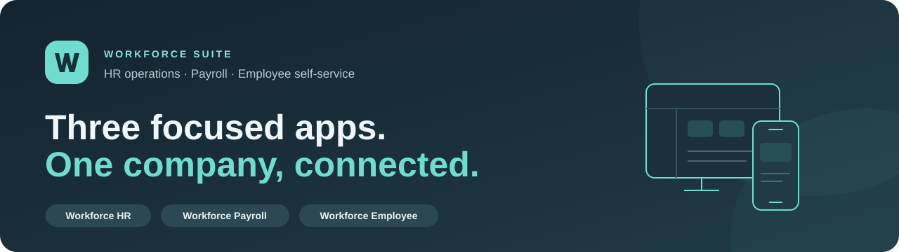
</p>

<p align="center">
  
  
  
  
  
</p>

<p align="center">
  <strong>HR operations, dedicated payroll and everyday employee services.</strong><br>
  Three applications share the same company records, with access shaped by each person's responsibilities.
</p>

<p align="center">
  <a href="#the-apps">The apps</a> ·
  <a href="#application-tour">Application tour</a> ·
  <a href="#installation-and-updates">Install</a> ·
  <a href="#developer-setup">Developer setup</a> ·
  <a href="#documentation">Documentation</a>
</p>

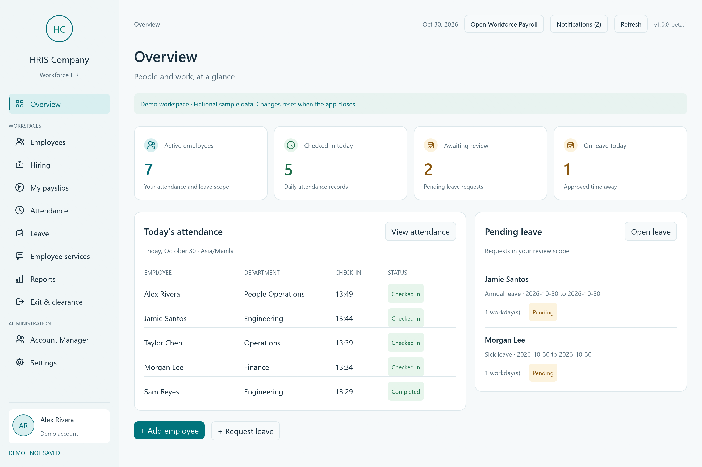

<p align="center"><sub>Actual native application preview · Fictional demonstration data · Teal light and charcoal dark themes</sub></p>

## The apps

| Application | For | Workspace | Current release |
| --- | --- | --- | --- |
| **Workforce HR** | Administrators, HR staff and assigned managers | People, hiring, time and leave, employee services, development and reporting | [1.0.0-beta.1 · Source](https://github.com/tatselkrik/workforce-suite/releases/tag/hr-v1.0.0-beta.1) |
| **Workforce Payroll** | Payroll Officers and Administrators | Pay preparation, independent approval, payslips, receipts and statutory review | [1.0.0-beta.1 · Source](https://github.com/tatselkrik/workforce-suite/releases/tag/payroll-v1.0.0-beta.1) |
| **Workforce Employee** | Employees, including staff viewing their own records | Attendance, leave, approved payslips, requests, profile and device alerts | [1.0.0-beta.2 · Source](https://github.com/tatselkrik/workforce-suite/releases/tag/employee-v1.0.0-beta.2) |

Each company installation uses its own packaged Supabase configuration. Users sign in to their company account without selecting a database or company. The three apps share that deployment; a different company receives a separate deployment.

The apps advance independently. Source snapshots are public; company-configured installers and APKs stay local to the deployment operator.

## Core capabilities

| Area | Included workflows |
| --- | --- |
| **People and employment** | Employee directory, reporting relationships, organization chart, contact and emergency details, employment history, contracts, attachments and digital 201 files |
| **Hiring and separation** | Applicants, résumés, interviews, feedback, offers, onboarding and exit/clearance tracking |
| **Time and leave** | Shift schedules, breaks, attendance corrections, overtime requests, holidays, workweeks, half-days, dated policies, balances and approval chains |
| **Learning and performance** | Goals, appraisals, feedback, learning records, certifications and career plans |
| **HR services** | Confidential employee-relations cases, routed employee requests, benefits eligibility, enrollments and dependents |
| **Payroll** | Salaries, allowances, deductions, Philippine premium calculations, cutoff payroll, 13th-month pay, annual-tax review, payments, final pay and linked amendments |
| **Reports and exchange** | Scoped attendance/leave reports, workforce and leadership summaries, configurable columns, bounded CSV/XLSX imports and exports |

Access is enforced through protected server permissions. Confidential cases, payroll administration and employee self-service retain separate scopes even though they share the same deployment.

## Application tour

These are actual app renders with **fictional demonstration data**. Desktop previews use the native screenshot harness; employee previews use the owned Android emulator. They do not show company records or prove authenticated production acceptance. [Screenshot sources and scope](docs/screenshots/workforce-beta1/README.md).

### Workforce HR

An overview of current work leads into employee records and focused HR workspaces. Company branding stays separate from the application name.

<details>
<summary><strong>Employee directory — records, organization and development</strong></summary>

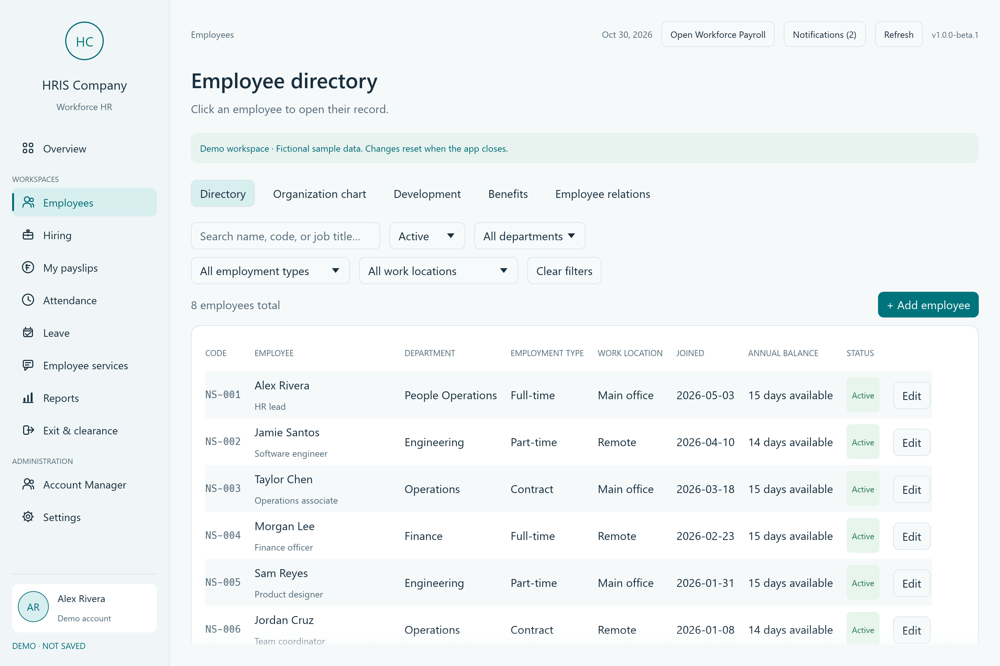

</details>

<details>
<summary><strong>Company sign-in — existing account and familiar branding</strong></summary>

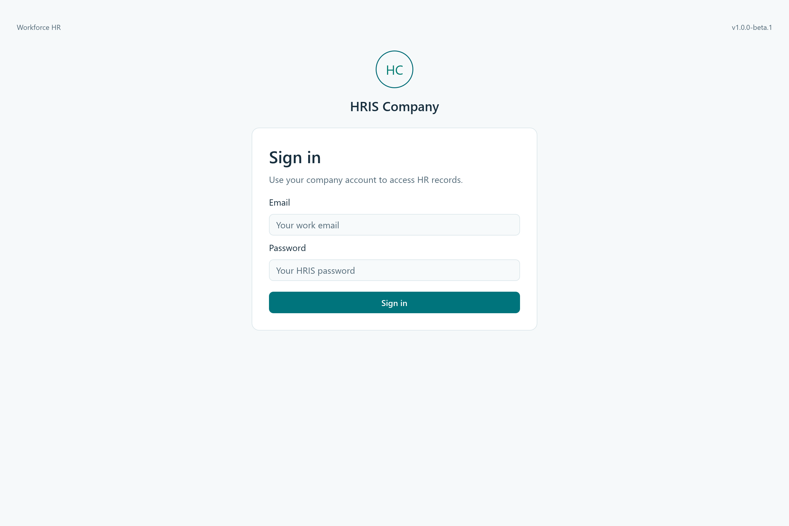

</details>

### Workforce Payroll

A separate desktop keeps financial administration focused while retaining the same employee records and original payroll history. Preparation and independent approval remain distinct.

<details>
<summary><strong>Monthly register — preparation, review and exports</strong></summary>

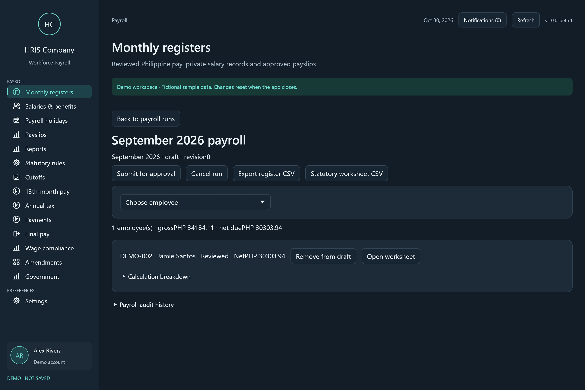

</details>

<details>
<summary><strong>Display preferences — shared visual language, separate app</strong></summary>

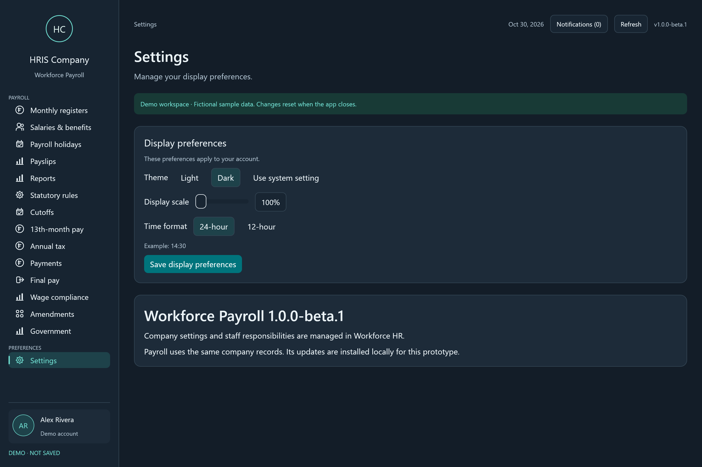

</details>

### Workforce Employee

The Android app connects directly to the company's backend. It does not depend on a PC browser server. Staff accounts receive the same own-record view when using it.

<p align="center">
  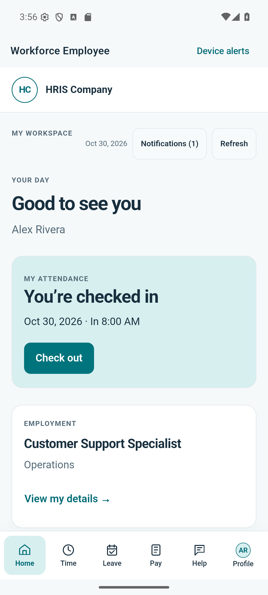
  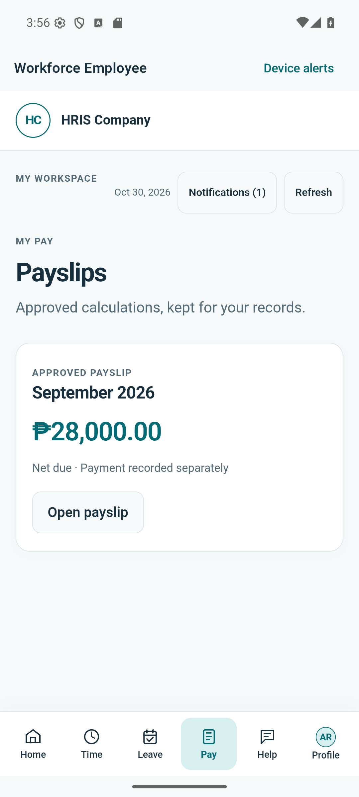
  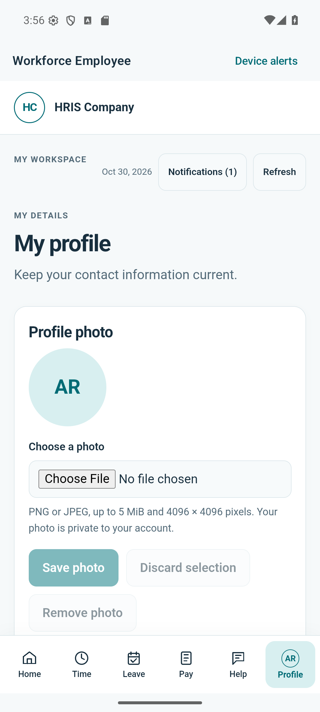
</p>

<p align="center"><sub>Home and attendance · Own payslips · Profile and contact details</sub></p>

<details>
<summary><strong>Android company sign-in</strong></summary>

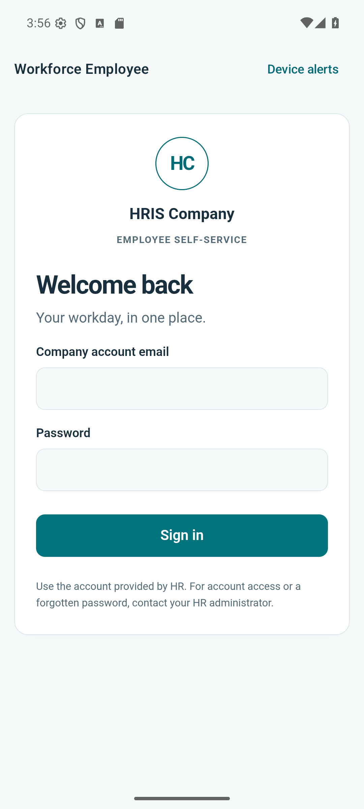

</details>

## Current app family

- **A coordinated suite:** Workforce HR, Workforce Payroll and Workforce Employee now have clear names and independent release tags in one repository.
- **Consistent appearance:** teal light and charcoal dark themes across the three applications.
- **Compatible upgrades:** existing application IDs, signing identities, company connections, installation/data paths and original records are retained.
- **Prerelease ordering:** desktop version comparison recognizes beta versions and a later stable `1.0.0` correctly.

Workforce HR and Payroll are at `1.0.0-beta.1`; Workforce Employee is at `1.0.0-beta.2`. Android is the employee-facing app. The former standalone browser portal is retired; its shared Rust service remains part of Android.

## Installation and updates

The public releases contain **source snapshots**, not a connection to the maintainer's company backend. To use the suite, a deployment operator creates a separate company Supabase project, applies the matching migrations/functions, and packages its own publishable configuration. Android also uses that company's Firebase configuration and signing identity. Start with [configuration examples](config-examples/README.md).

Company-configured installers and signed APKs are distributed by the deployment operator and stay outside this repository. Install over the matching existing app after saving work. Existing application IDs, signing identities and legacy installation/data paths are retained across the Workforce rename. The current Android version code is **5**.

The employee application is Android-only; there is no standalone PC browser server to run or maintain. Users sign in to their packaged company account without an in-app database chooser. Product updates, backend deployment and source publication are separate operations.

## How the suite fits together

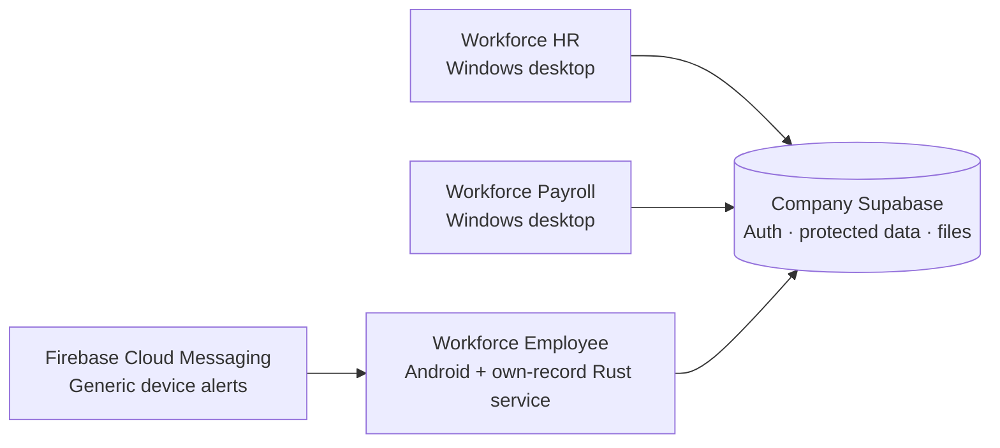

Desktop financial screens use shared Rust code rather than separate calculation implementations. Android embeds the own-record service behind a private device-loopback interface. There is no standalone browser application; `employee-portal/` retains its historical name as the shared Android employee-service library.

## Developer setup

The repository keeps the established source layout and pinned lockfiles:

```text
workforce-suite/
├── src/                 Workforce HR and shared Rust implementation
├── payroll-desktop/     Workforce Payroll executable
├── employee-android/    Android shell, lifecycle and Rust bridge
├── employee-portal/     Shared own-record service library for Android
├── supabase/            Versioned migrations and protected functions
├── tests/               Workflow, transport and release checks
├── tools/               Build, packaging and verification utilities
└── docs/                Contracts, delivery evidence and screenshots
```

On a configured Windows development workstation with Rust/MSVC:

```powershell
cargo test --workspace --locked
cargo build --workspace --release --locked
```

The outputs retain the compatible names `hris-desktop.exe` and `payroll-desktop.exe`. See the [Android guide](employee-android/README.md) for its pinned SDK/JDK/Gradle toolchain and private packaging workflow. Deployment profiles, Firebase configuration and signing keys must be supplied privately; they are excluded from Git.

The workflow checks public source, employee-service behaviour, native builds and database contracts on standard public GitHub-hosted runners. It does not upload configured packages, use deployment secrets or apply hosted migrations. Local company packaging is separate from CI.

## Prototype boundaries

- **Private by design:** credentials, signing keys, company records, deployment profiles, database dumps and build caches are excluded from source. Client packages contain publishable configuration; server keys must never enter an app.
- **Recorded transactions:** payroll payment and remittance records do not transfer money or file government returns. Agency file preparation is distinct from official validator acceptance.
- **Verification scope:** current releases have local/emulator evidence. Physical-phone/OEM behavior, actual email confirmation and subjective monitor review remain separately documented.
- **Deferred connections:** biometric integration stays visible and disabled while no hardware is selected. Paid services and declined external accounting/payroll integrations are outside the active prototype scope.

## Documentation

| Start here | Reference |
| --- | --- |
| Releases, tags and compatibility | [Release/version policy](docs/WORKFORCE-RELEASES.md) |
| Company packaging inputs | [Configuration examples](config-examples/README.md) |
| Remaining and deferred work | [Roadmap](docs/REMAINING-ROADMAP.md) |
| Payroll architecture | [Separate Payroll Desktop](docs/PAYROLL-DESKTOP.md) |
| Android build and operation | [Employee app guide](employee-android/README.md) |
| Android notifications | [Protected push pipeline](docs/ANDROID-PUSH.md) |
| Screenshot provenance | [Reviewed gallery](docs/screenshots/workforce-beta1/README.md) |

<p align="center"><sub>Workforce Suite · Public source, company-specific deployments · Built with Rust</sub></p>
